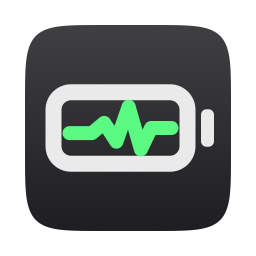
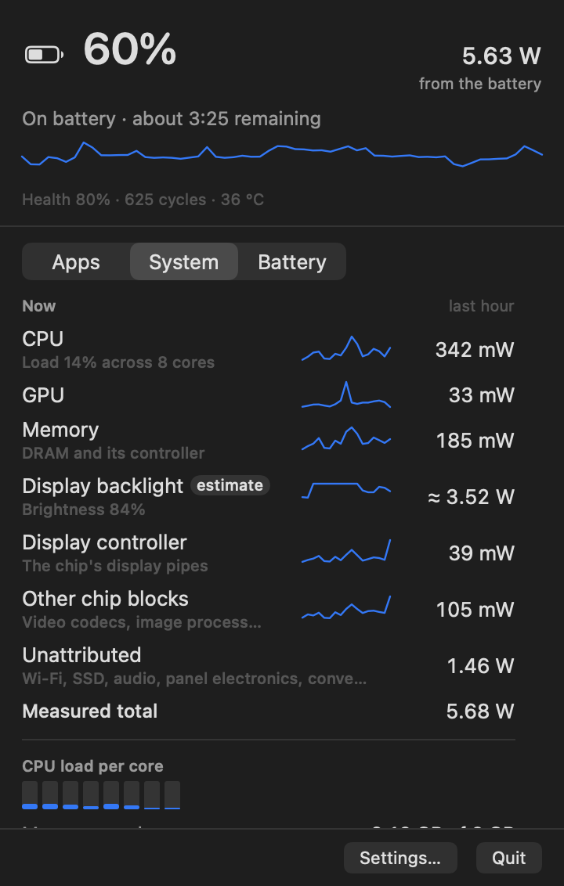

<p align="center">
  
</p>

# Battery Trace for Mac

<p align="center">
  <a href="https://github.com/kevinabouhanna/BatteryTrace/releases/latest"></a>
  
  <a href="https://github.com/kevinabouhanna/BatteryTrace/actions/workflows/ci.yml"></a>
  
</p>

<p align="center">
  <a href="https://github.com/kevinabouhanna/BatteryTrace/releases/latest/download/BatteryTrace.dmg"><b>Download</b></a> ·
  <a href="docs/ATTRIBUTION.md">How it works</a> ·
  <a href="docs/VALIDATION.md">Validation</a>
</p>

A menu bar app that shows where your Mac's power goes. It splits power by app,
and shows what isn't an app at all: the display, the CPU, GPU, Neural Engine,
memory and the rest of the chip.

- **Light.** Sampling costs about 0.015% of one core while the window is
  closed. See [docs/PERFORMANCE.md](docs/PERFORMANCE.md).
- **Honest.** The total is measured. Per-app figures are estimates, and the UI
  labels them as estimates. Whatever no counter accounts for stays in its own
  Unattributed row, so the rows always add up to what was measured. See
  [docs/ATTRIBUTION.md](docs/ATTRIBUTION.md).
- **No root, no permissions, no dependencies.**

<p align="center"></p>

## Install

For macOS 14 or later, on Apple silicon or Intel.

1. [**Download BatteryTrace.dmg**](https://github.com/kevinabouhanna/BatteryTrace/releases/latest/download/BatteryTrace.dmg),
   open it, and drag Battery Trace into **Applications**.
2. Open Battery Trace. macOS says it can't check it for malicious software.
   Close that message.
3. Open **System Settings › Privacy & Security**, scroll down to **Security**,
   click **Open Anyway** next to Battery Trace, and confirm with your password.

> [!NOTE]
> **Why the extra step?** Battery Trace isn't signed with a paid Apple
> Developer ID yet, so macOS can't confirm who made it. The code is all here to
> read, or to build yourself (below).

Look for the ⚡︎ reading in your menu bar. Click it for the popover; right-click
it, or click it with two fingers, for Settings and Quit. To have it start at
login, turn on **Settings › General › Open at login**.

### Update

Battery Trace never goes online by itself, so it can't tell you about new
versions. To hear about them, click **Watch › Custom › Releases** at the top of
this page.

To update, download the new disk image and drag Battery Trace into
Applications, choosing **Replace**. Your settings and history are kept. macOS
checks each new version afresh, so approve it with **Open Anyway** once more.

### Uninstall

Quit Battery Trace from its right-click menu, turn off **Open at login** first
if you turned it on, and drag it from Applications to the Trash. To remove its
history and settings too:

```sh
rm -rf ~/Library/"Application Support/Battery Trace"
defaults delete app.batterytrace.BatteryTrace
```

## Requirements

- macOS 14 or later.
- Apple silicon. Intel Macs run it with fewer metrics; see the limitations below.
- To build: Xcode 16 or later. Tested with Xcode 27.0 and Swift 6.4 on a
  MacBook Air (M1, 2020) running macOS 27.0.1.

## Build and run

- **In Xcode:** open `BatteryTrace.xcodeproj` and run the **BatteryTrace**
  scheme. The app appears in the menu bar, with no Dock icon. Click it for the
  popover; right-click (or two-finger click) it for Settings, About and Quit.
- **From the command line:**
  ```sh
  make app      # build/DerivedData/Build/Products/Release/Battery Trace.app
  make run      # build and open it
  make test     # 44 unit tests: attribution, grouping, storage, sampling policy
  make install  # into /Applications, and open it
  ```
- **Tests in Xcode:** open `BatteryTraceKit/Package.swift` and test the
  **BatteryTraceKit-Package** scheme. From the command line that's
  `cd BatteryTraceKit && xcodebuild test -scheme BatteryTraceKit-Package -destination 'platform=macOS'`.

The build is signed to run locally. To give it to someone else, set your team
in Signing & Capabilities and notarize it. It runs outside the Mac App Store
because it uses private interfaces (see below).

### `bttrace`: the sampling layer without the UI

```sh
make cli                       # BatteryTraceKit/.build/release/bttrace
bttrace sources                # what each data source found on this Mac
bttrace sample --processes     # three 5 s intervals, attributed like the app does
bttrace totals                 # minute by minute, against the battery gauge
bttrace cost                   # what sampling costs, per tick and per minute
make validate                  # rank apps against top's Energy Impact (no password)
make validate-powermetrics     # against sudo powermetrics, four scenarios (asks for your password)
make measure                   # the built app's own CPU, Energy Impact and memory
```

## What the numbers mean

| Shown as | What it is | Measured or estimated |
|---|---|---|
| **Watts** in the menu bar and summary | Total system power from the SMC's power sensor, averaged over the last three readings | Measured |
| **"from the battery"** / **"power draw, not from battery"** | On battery, that power drains the battery. On the adapter it doesn't, and the label says so. | — |
| **Time remaining**, health, cycles, temperature | From macOS's battery gauge. Temperature comes from the SMC. | Measured (time remaining is macOS's own estimate) |
| **Apps**, with share and energy (mWh) | The CPU, GPU and Neural Engine energy the chip measured, split by the kernel's per-app energy counters. Helpers and XPC services count for their app. | **Estimated** (marked "Estimated") |
| **Child processes** | That app's CPU share, split by each process's own energy counter. The rest is "Other or exited processes". | Estimated |
| **System / Unattributed** | Everything that isn't an app: display, memory, other chip blocks, and the measured power no counter accounts for | Measured, except the display |
| **CPU, GPU, Neural Engine, Memory** | The chip's energy counters (IOReport, PMP group) | Measured by the chip's power manager |
| **Display backlight** | Brightness mapped to watts by a curve fitted against the power sensor | **Estimate** (labelled) |
| **Display controller, other chip blocks** | The chip's display pipes; video codecs, image processor, always-on blocks | Measured |
| **Unattributed** | Measured total minus every component: Wi-Fi, SSD, audio, panel electronics, power conversion | Measured remainder |
| **Totals for 5 min, 1 hour, 24 hours** | The battery gauge's own running averages when they cover the window, otherwise the power sensor | Measured |

## How it works

| Layer | Module | Does |
|---|---|---|
| Sources | `PowerSources` | Reads IOKit, libproc and private interfaces: one type per source, all behind protocols. The only module that touches private APIs. |
| Sampling | `Sampling` | Runs a `DispatchSourceTimer` with leeway on a utility queue. A cheap live reading for the menu bar every 5 s, and attribution every 60 s (every 2 s with the window open). Slower in Low Power Mode and while the screens sleep, stopped while the Mac sleeps. |
| Attribution | `Attribution` | Pure, unit-tested functions: groups processes into apps, splits the energy, builds window totals |
| Storage | `Storage` | One SQLite file, `~/Library/Application Support/Battery Trace/history.sqlite`. Live readings for an hour, minutes for 7 days, app minutes for 24 h, then hours. Written every 5 minutes, pruned hourly, capped at 64 MB. |
| UI | `App/` | `NSStatusItem` and `NSPopover` with SwiftUI. Views exist only while the popover is open. |

A new metric is one type conforming to `ComponentSource` (energy) or
`SnapshotSource` (anything else). A privileged source, such as a future
`powermetrics` helper, would conform to `PowerMetricsProvider` and replace the
unprivileged one without other changes.

### Private interfaces, and what happens if Apple changes them

All are looked up at run time. A missing one hides its metric; the app doesn't crash.

| Interface | For | If it's gone |
|---|---|---|
| `libIOReport` (PMP and Energy Model energy counters) | CPU, GPU, ANE, memory and other chip blocks | Components hidden. App shares fall back to the kernel's own energy figures, marked as estimates. |
| `coalition_info_resource_usage`, `PROC_PIDCOALITIONINFO` | Per-app energy for every process, including root's | Per-process energy for your own processes only, grouped by app bundle and parent process |
| SMC user client, key `PSTR` | Live total power | The battery gauge's once-a-minute figure |
| `DisplayServicesGetBrightness` | Brightness for the display estimate | IORegistry brightness, which may be stale |
| `AppleSmartBattery` registry keys | Battery state, gauge telemetry | Each missing key hides one figure |

## Known limitations

- **Per-app figures are estimates.** They come from the kernel's energy model
  (CLPC) and the GPU driver's accounting.
- **Work done on an app's behalf is counted for whoever did it.** WindowServer
  draws windows, `coreaudiod` mixes audio, and the video decoder decodes video.
  Under heavy GPU load, macOS charges WindowServer for much of the GPU's time.
- **The CPU row reads about 0.3 W below `powermetrics`.** Apple has two CPU
  energy counters; the one `powermetrics` uses is only refreshed for root.
  The difference stays inside Unattributed.
- **The display estimate was calibrated on one MacBook Air panel.** It doesn't
  model HDR/XDR or ProMotion. Recalibrate with `bttrace calibrate-display`.
- **Unattributed is typically 25–40% at light load,** and more while streaming
  (Wi-Fi, audio). It isn't spread across apps.
- **Intel Macs** have no IOReport energy counters and often no `PSTR`: fewer
  components, and app shares from the kernel's CPU model alone.

Validation results: [docs/VALIDATION.md](docs/VALIDATION.md).

## Privacy

No network access, no telemetry, no account. History stays in the SQLite file
above; delete it to start over.

## Recommended next features

1. **An optional privileged helper** (an `SMAppService` daemon running
   `powermetrics`), behind the existing `PowerMetricsProvider` protocol. It
   would give per-process energy for every process, and Apple's own CPU figure.
2. **"Billed to me" attribution.** Move energy that daemons spend on an app's
   behalf back to that app, using the kernel's `energy_billed_to_me` counters.
3. **Notifications for battery-hungry apps.** For example: "Chrome has used 18%
   of your battery in the last hour".
4. **Export history to CSV.**
5. **Per-tab browser attribution.** Safari's and Chrome's renderers carry their
   tab in their process names or arguments.
6. **Per-model display calibration.** Ship curves for each MacBook panel, and
   model external displays and HDR.
7. **Charging history and battery-health trend.**
8. **Signed, notarized builds and an update channel.**

## Project layout

```
BatteryTrace.xcodeproj   app target (App/) linking the local package
App/                     AppKit + SwiftUI shell: status item, popover, settings
BatteryTraceKit/         Swift package: Core, PowerSources, Attribution, Sampling, Storage, bttrace, tests
Scripts/                 validation and measurement scripts
docs/                    PLAN, ATTRIBUTION, VALIDATION, PERFORMANCE
```

The icon is drawn by `Scripts/make-icon.swift`; run `swift Scripts/make-icon.swift`
after changing it.
